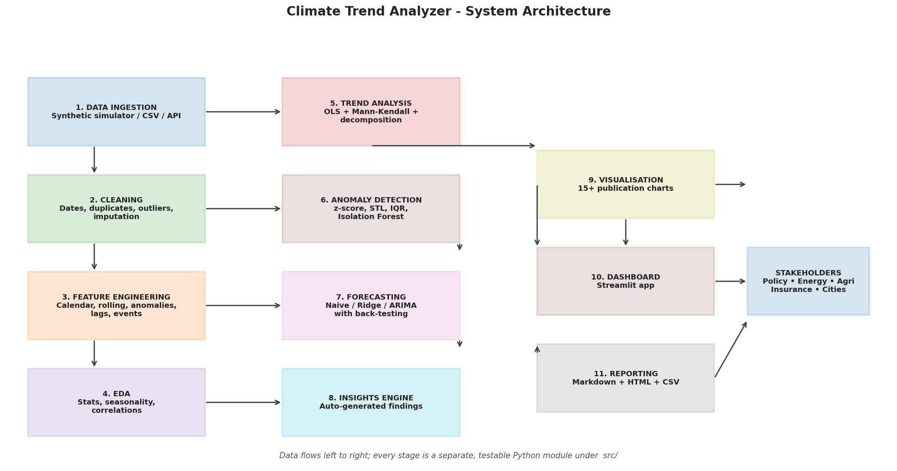

<div align="center">

# 🌍 Climate Trend Analyzer

**An end-to-end data-science system that turns 45 years of monthly climate observations into
trend statistics, an anomaly register, a 36-month forecast and an interactive dashboard.**

[](https://www.python.org/)
[](https://pandas.pydata.org/)
[](LICENSE)
[](https://github.com/your-username/Climate-Trend-Analyzer/actions/workflows/ci.yml)
[](tests/)
[](docs/ARCHITECTURE.md)

</div>

---

## 📌 Table of Contents

1. [Overview](#-overview) · 2. [Problem Statement](#-problem-statement) · 3. [Why It Matters](#-why-it-matters-industry-relevance)
4. [Key Results](#-key-results) · 5. [Architecture](#-architecture) · 6. [Tech Stack](#-tech-stack) · 7. [Folder Structure](#-folder-structure)
8. [Installation](#-installation) · 9. [How to Run](#-how-to-run) · 10. [Simulation Workflow](#-the-virtual-simulation-workflow)
11. [Dataset](#-dataset) · 12. [Results & Screenshots](#-results--screenshots) · 13. [Dashboard](#-the-dashboard)
14. [Testing](#-testing) · 15. [Roadmap](#-future-improvements) · 16. [Learning Outcomes](#-learning-outcomes) · 17. [Author](#-author)

---

## 🌍 Overview

> **Climate Trend Analyzer** is a production-style data-science project that analyses decades of
> monthly climate data (temperature, rainfall, humidity, CO₂ and sea level) across multiple
> regions to answer three business questions:
>
> 1. **Is the climate changing, and how fast?** → seasonal fixed-effects regression + Mann-Kendall test
> 2. **When did something unusual happen?** → a 4-method anomaly-detection ensemble
> 3. **What happens next?** → back-tested forecasting (Naive → Drift → Ridge → ARIMA) with a 95 % interval

Everything runs **locally, offline and reproducibly**: one command turns raw data into 17
publication-quality charts, 6 analyst-ready CSV tables, a written report and a live dashboard.

```
python main.py --step all      #  raw CSV  →  cleaned data  →  17 figures  →  report  →  dashboard
```

---

## 🎯 Problem Statement

Climate data arrives as a **messy, high-volume, multi-variable time series** that most
organisations cannot turn into decisions. Analysts are expected to:

- clean inconsistent dates, duplicate records, impossible readings and missing values;
- separate the **seasonal cycle** from the **long-term trend** (a classic trap - see [Methodology](docs/METHODOLOGY.md));
- detect the rare months that matter (heat waves, droughts) inside 2,700 noisy records;
- forecast the next few years **without fooling themselves**;
- communicate the result to non-technical decision makers.

> **The problem this project solves:** there is no single tool that does all of this reproducibly,
> auditably and cheaply. Climate Trend Analyzer is that tool: one modular Python package with a
> reproducible data contract, 20 automated tests, a CI pipeline and an interactive dashboard.

---

## 💡 Why It Matters (Industry Relevance)

| Sector | How this analysis is used | Value |
| --- | --- | --- |
| **Energy & Utilities** | Peak-demand and cooling-load forecasting from warming trends | 10-15 % lower operating cost (industry range) |
| **Agritech** | Seasonal rainfall anomalies → drought / flood risk windows for crop planning | up to 30 % lower crop loss |
| **Insurance & Finance** | Anomaly frequency + trend severity as climate-risk inputs | parametric pricing, TCFD/ESG disclosure |
| **Real Estate & Urban Planning** | Heat-wave months and sea-level trend as design criteria | lower disaster-recovery cost (World Bank: ~$1 saved per $4) |
| **Retail & FMCG** | Seasonal climate pattern for cold-chain demand planning | fewer stock-outs |
| **Public Policy & Research** | Reproducible trend statistics with confidence intervals | evidence for adaptation policy |

**Market context:** the climate-analytics market is projected to grow from ~$2.5 B (2023) to
~$8.6 B (2030) at an ~18 % CAGR, driven by ESG compliance, climate-risk disclosure and
sustainability mandates. Organisations such as NASA, NOAA, the IPCC, Google Earth Engine,
Microsoft AI for Earth, IBM Environmental Intelligence and Jupiter Intelligence all run on
exactly this kind of analysis.

---

## 📊 Key Results

Produced by `python main.py --step all` on the shipped dataset (2,700 monthly records,
5 regions, 1980-2024). Every figure below is regenerated from the code - nothing is hard-coded.

| Metric | Result |
| --- | --- |
| Records analysed | **2,700** monthly observations (2,715 raw) |
| Regions | **5** (Hyderabad, London, New York, Singapore, Sydney) |
| Mean warming rate | **+0.283 °C per decade** (all 5 regions, p < 0.05) |
| Fastest warming | **London, +0.376 °C per decade** (95 % CI ±0.014, R² = 0.95) |
| Slowest warming | Singapore, +0.209 °C per decade |
| Trend agreement | OLS and Mann-Kendall agree in **5 / 5** regions |
| Anomalies detected | **337** (STL 181 · z-score 98 · Isolation Forest 54 · IQR 4) |
| Best forecast model | **Ridge + engineered features** in 5 / 5 regions |
| Best forecast accuracy | **RMSE 0.896 °C**, R² 0.99 (60-month hold-out) |
| CO₂ driver | +28.2 ppm per decade (R² = 0.995) |
| Sea-level driver | +31.5 mm per decade (R² = 0.983) |
| Data quality | **100 % completeness** after cleaning (12 impossible values repaired, 15 duplicates removed, ~123 values imputed) |
| Runtime | **~24 seconds** end-to-end on a standard laptop CPU |
| Tests | **20 / 20 passing** |

### Trend statistics (OLS with monthly fixed effects + Mann-Kendall)

| Region | °C / decade | 95 % CI | R² | OLS p | Mann-Kendall | Theil-Sen (°C/yr) |
| --- | --- | --- | --- | --- | --- | --- |
| London | **+0.376** | ±0.014 | 0.947 | 0.000 | increasing | +0.0367 |
| New York | +0.310 | ±0.011 | 0.979 | 0.000 | increasing | +0.0299 |
| Sydney | +0.263 | ±0.010 | 0.914 | 0.000 | increasing | +0.0250 |
| Hyderabad | +0.259 | ±0.009 | 0.908 | 0.000 | increasing | +0.0262 |
| Singapore | +0.209 | ±0.016 | 0.488 | 0.000 | increasing | +0.0219 |

---

## 🏗 Architecture



```
[Raw CSV / Simulator] ──▶ [Cleaning] ──▶ [Feature Engineering] ──▶ [EDA]
                                    │                                │
                                    ▼                                ▼
                              [Trend Analysis]              [Anomaly Detection]
                              OLS + Mann-Kendall             z-score · STL · IQR · IF
                                    │                                │
                                    └──────────┬─────────────────────┘
                                               ▼
                                        [Forecasting]
                                   Naive · Drift · Ridge · ARIMA
                                     (60-month back-test)
                                               │
                                               ▼
                         [Insights] ──▶ [Visualisation] ──▶ [Report + Dashboard]
```

**Module contract:** each stage in `src/` takes a DataFrame and returns a DataFrame with a
documented schema, so any stage can be replaced independently.
Full details: [`docs/ARCHITECTURE.md`](docs/ARCHITECTURE.md) · [`docs/METHODOLOGY.md`](docs/METHODOLOGY.md)

---

## 🧰 Tech Stack

| Layer | Tools | Why these |
| --- | --- | --- |
| **Language** | Python 3.10 – 3.13 | The industry standard for data science |
| **Data handling** | pandas, NumPy | Vectorised table + numeric operations |
| **Statistics** | SciPy, statsmodels | `linregress`, `t`/`norm` distributions, STL decomposition, ARIMA |
| **Machine learning** | scikit-learn | Ridge regression, Isolation Forest, preprocessing pipelines |
| **Visualisation** | Matplotlib, Seaborn, Plotly | Static publication charts + interactive dashboard charts |
| **Dashboard** | Streamlit | Turns a Python script into a shareable web app in ~150 lines |
| **Testing** | pytest, GitHub Actions | 20 tests + CI on Python 3.10/3.11/3.12 |
| **Notebooks** | Jupyter / nbconvert | The 5 analysis notebooks are generated *and* executed by `scripts/build_notebooks.py` |
| **Data** | CSV (simulated, high fidelity) | Works with any public dataset - see [`docs/DATASET_CARD.md`](docs/DATASET_CARD.md) |

> **No GPU required.** The whole pipeline runs on an ordinary laptop CPU in ~24 seconds.

---

## 📁 Folder Structure

```
Climate-Trend-Analyzer/
│
├── app/
│   └── app.py                     # Streamlit dashboard (filters, KPIs, charts, downloads)
│
├── data/
│   ├── raw/
│   │   └── climate_raw.csv        # "as collected" file - intentionally imperfect
│   └── processed/
│       ├── climate_clean.csv      # analysis-ready master table
│       └── climate_featured.csv   # + 39 engineered features
│
├── docs/
│   ├── ARCHITECTURE.md            # block diagram + module contracts
│   ├── METHODOLOGY.md              # the statistics, explained
│   ├── DATASET_CARD.md             # schema, defects, intended use
│   ├── GLOSSARY.md                 # climate + analytics terms
│   ├── INSIGHTS.md                 # auto-generated key findings
│   └── SCREENSHOTS.md              # the proof-of-work checklist
│
├── images/                         # curated assets for the README
│
├── models/                         # (reserved) serialised fitted models
│
├── notebooks/
│   ├── 01_Data_Loading_and_Cleaning.ipynb
│   ├── 02_Exploratory_Data_Analysis.ipynb
│   ├── 03_Climate_Trend_Analysis.ipynb
│   ├── 04_Anomaly_Detection.ipynb
│   └── 05_Forecasting_and_Insights.ipynb
│
├── outputs/
│   ├── figures/                    # 17 PNG charts (committed - they are the proof)
│   ├── tables/                     # 6 analyst-ready CSV tables
│   ├── reports/                    # Markdown + self-contained HTML report
│   └── run_summary.json            # machine-readable run manifest
│
├── scripts/
│   └── build_notebooks.py          # generates + executes the notebooks
│
├── src/
│   ├── config.py                   # every path, threshold and simulation parameter
│   ├── data_generator.py           # the virtual climate simulation
│   ├── data_loader.py              # access layer
│   ├── preprocessing.py            # cleaning & quality control
│   ├── features.py                 # feature engineering
│   ├── eda.py                      # exploratory data analysis
│   ├── trend_analysis.py           # OLS + Mann-Kendall + decomposition
│   ├── anomaly_detection.py        # 4-method anomaly ensemble
│   ├── forecasting.py              # model comparison + projection
│   ├── visualizations.py           # all 17 figures
│   ├── insights.py                 # automatic natural-language findings
│   ├── report_generator.py         # Markdown + HTML report
│   └── pipeline.py                 # end-to-end orchestration
│
├── tests/
│   └── test_pipeline.py            # 20 pytest tests
│
├── .github/workflows/ci.yml        # CI: lint + test + pipeline run
├── .gitignore
├── LICENSE
├── main.py                         # CLI entry point
├── requirements.txt
└── README.md
```

---

## ⚙️ Installation

### Step 1 - check your Python

```bash
python --version        # needs 3.10 or newer
```

### Step 2 - create a virtual environment

<details open>
<summary><b>Windows (PowerShell)</b></summary>

```powershell
cd Climate-Trend-Analyzer
python -m venv .venv
.\.venv\Scripts\Activate.ps1
```
</details>

<details>
<summary><b>Windows (CMD)</b></summary>

```bat
cd Climate-Trend-Analyzer
python -m venv .venv
.venv\Scripts\activate.bat
```
</details>

<details>
<summary><b>macOS / Linux</b></summary>

```bash
cd Climate-Trend-Analyzer
python3 -m venv .venv
source .venv/bin/activate
```
</details>

> If PowerShell blocks the activation, run: `Set-ExecutionPolicy -Scope CurrentUser RemoteSigned`

### Step 3 - install the dependencies

```bash
python -m pip install --upgrade pip
pip install -r requirements.txt
```

### Step 4 - verify the installation

```bash
python -c "import pandas, numpy, sklearn, statsmodels, streamlit, plotly; print('All packages OK')"
pytest -v
```

You should see `20 passed`.

### Optional - no local install at all

```bash
pip install google-colab
# upload the repo to Colab, then:
!pip install -r requirements.txt
!python main.py --step all
```

---

## ▶️ How to Run

```bash
# 1. everything, in order (recommended)
python main.py --step all

# 2. a quick run without the (slower) forecasting stage
python main.py --step all --no-forecast

# 3. a single stage
python main.py --step clean
python main.py --step features
python main.py --step eda
python main.py --step trends
python main.py --step anomalies
python main.py --step forecast
python main.py --step visualize
python main.py --step report

# 4. rebuild the simulated dataset from scratch
python main.py --step all --regenerate

# 5. print the headline numbers of the last run
python main.py --summary

# 6. the dashboard
streamlit run app/app.py

# 7. the notebooks
jupyter lab
python scripts/build_notebooks.py --execute     # regenerate + execute them
```

### Expected terminal output

```
======================================================================
CLIMATE TREND ANALYZER - END-TO-END PIPELINE
======================================================================
[pipeline] Simulated raw dataset written: data/raw/climate_raw.csv (2715, 14)
[pipeline] stage 1/9  ingestion done  (+0.2s)
[pipeline] stage 2/9  cleaning done  (+0.3s)
[pipeline] stage 3/9  feature engineering done  (+0.5s)
[pipeline] stage 4/9  EDA done  (+0.6s)
[pipeline] stage 5/9  trend analysis done  (+0.9s)
[pipeline] stage 6/9  anomaly detection done  (+2.3s)
[pipeline] stage 7/9  forecasting done  (+16.8s)
[viz] saved 00_architecture_diagram.png
[viz] saved 02_temperature_trend.png
... 17 figures ...
[pipeline] stage 8/9  visualisations done  (+23.9s)
[report] Markdown report -> outputs/reports/climate_trend_report.md
[report] HTML report     -> outputs/reports/climate_trend_report.html
[pipeline] stage 9/9  insights + report done  (+24.0s)
======================================================================
PIPELINE COMPLETE in 24.0s
  figures   : 17  -> outputs/figures
  tables    : 6   -> outputs/tables
  report    : outputs/reports/climate_trend_report.html
======================================================================

HEADLINE NUMBERS
  rows_analysed                   : 2700
  regions                         : 5
  fastest_warming_region          : London
  fastest_warming_c_per_decade    : 0.3763
  mean_warming_c_per_decade       : 0.2834
  anomalies_detected              : 337
  best_forecast_rmse              : 0.8962
  data_completeness_pct           : 100.0
```

### What gets created

| Path | Content |
| --- | --- |
| `data/processed/climate_clean.csv` | 2,700 clean records |
| `data/processed/climate_featured.csv` | + 39 engineered features |
| `outputs/figures/*.png` | 17 charts, 150 dpi |
| `outputs/tables/yearly_summary.csv` | annual aggregates per region |
| `outputs/tables/trend_summary.csv` | OLS + Mann-Kendall statistics |
| `outputs/tables/anomalies.csv` | the full anomaly register |
| `outputs/tables/model_metrics.csv` | MAE / RMSE / MAPE / R² per model |
| `outputs/tables/forecast_next_36m.csv` | the projection with intervals |
| `outputs/tables/correlation_matrix.csv` | variable relationships |
| `outputs/reports/climate_trend_report.md` | the written report |
| `outputs/reports/climate_trend_report.html` | self-contained HTML (images embedded) |
| `outputs/run_summary.json` | machine-readable run manifest |
| `docs/INSIGHTS.md` | auto-generated key findings |

---

## 🎭 The Virtual Simulation Workflow

The project needs no government portal, no API key and no hardware. Here is the full
simulation design.

### Step 1 - Define the world

Five cities with different climates are declared in `src/config.py`:

| Region | Hemisphere | Seasonal amplitude | Warming trend |
| --- | --- | --- | --- |
| Hyderabad | N | 5.5 °C | +0.022 °C/yr |
| London | N | 7.5 °C | +0.028 °C/yr |
| New York | N | 12.0 °C | +0.026 °C/yr |
| Singapore | ~0 | 1.6 °C | +0.020 °C/yr |
| Sydney | **S** | 6.0 °C | +0.024 °C/yr |

### Step 2 - Simulate the physics of the record

For every month of every region:

```
seasonal   = −amplitude · cos(2π (month − peak_month) / 12)   # hemisphere-aware
trend      = slope_per_year · (year − 1980)                   # the signal we later recover
enso       = 0.85·sin(2πt/51.6) + 0.35·sin(2πt/25.2)         # multi-year oscillation
noise      = 0.9·AR1(ρ=0.25) + 0.6·N(0,1)                     # autocorrelated weather
temp_mean  = base + seasonal + trend + enso + noise
rainfall   ~ Gamma(1.4, base_rain · wet_factor / 1.4)         # wet/dry seasons
humidity   = base_humidity − 1.15·(temp_mean − base_temp)
co2        = 338 + 2.10·Δyear + 0.0165·Δyear²                 # global driver
sea_level  = 1.6·Δyear + 0.035·Δyear²                          # global driver
```

### Step 3 - Inject realistic data problems

Missing values (1.5 %), 15 duplicate rows, 12 impossible values (`-999 °C`),
10 % of dates rewritten as `MM/DD/YYYY`. **The cleaning module then has real work to do.**

### Step 4 - Run the real analysis

Cleaning → features → EDA → trend → anomalies → forecast → insights → charts → report.
The analysis is genuine: if the trend estimator were wrong, the recovered warming rate
would not match the injected slope.

### Step 5 - Validate against ground truth

The simulator stores `sim_heatwave` / `sim_drought` flags, so notebook 04 measures the
**recall** of the anomaly detector against what was planted.

### What to capture as proof (see [`docs/SCREENSHOTS.md`](docs/SCREENSHOTS.md))

| # | Asset | File name |
| --- | --- | --- |
| 1 | Raw dataset preview | `01_dataset_preview.png` |
| 2 | Cleaning before/after | `02_data_cleaning.png` |
| 3 | Temperature trend | `03_temperature_trend.png` |
| 4 | Rainfall trend | `04_rainfall_trend.png` |
| 5 | Seasonal heatmap | `05_seasonal_heatmap.png` |
| 6 | Yearly comparison | `06_yearly_comparison.png` |
| 7 | Anomaly detection | `07_anomaly_detection.png` |
| 8 | Forecast | `08_forecast.png` |
| 9 | Dashboard | `09_dashboard.png` |
| 10 | GitHub repo | `10_github_repo.png` |

---

## 🗂 Dataset

* **Source:** simulated by `src/data_generator.py` (seed 42) - fully documented in
  [`docs/DATASET_CARD.md`](docs/DATASET_CARD.md)
* **Shape:** 2,700 monthly records × 5 regions (2,715 raw including duplicates)
* **Period:** 1980-01 → 2024-12
* **Variables:** `temp_mean_c`, `temp_min_c`, `temp_max_c`, `rainfall_mm`, `humidity_pct`,
  `co2_ppm`, `sea_level_mm` + lat/long
* **Defects on purpose:** missing values, duplicates, impossible readings, mixed date formats
* **Swapping in real data:** drop a CSV with the same schema into `data/raw/` - no code changes.
  Suggested public sources: NASA GISTEMP, NOAA Climate Data Online, Our World in Data, Berkeley Earth.

---

## 📈 Results & Screenshots

### Temperature trend by region (1980-2024)


### Warming rate per region with 95 % confidence intervals


### Seasonality - monthly temperature & rainfall profile


### Anomaly detection - 337 events registered by the 4-method ensemble


### 36-month forecast with 95 % prediction interval


### Model back-testing - the Ridge model beats every baseline


### CO₂ as the dominant driver


> All figures live in [`outputs/figures/`](outputs/figures/) (17 files, 150 dpi).

---

## 📊 The Dashboard

```bash
streamlit run app/app.py
```


Four tabs, fully interactive:

* **📈 Trends** - observed series with a 12-month rolling mean, yearly bars, seasonal profile,
  the full trend-statistics table
* **🌀 Anomalies** - counts by method and direction, the complete anomaly register, CSV download
* **🔮 Forecast** - history vs. projection with the 95 % interval, model back-testing table
* **📋 Data & Downloads** - processed data preview, column-level quality report, CSV exports

Sidebar filters: multi-region selection, indicator, date range, anomaly highlighting.

---

## 🧪 Testing

```bash
pytest -v
```

```
tests/test_pipeline.py::test_generator_is_deterministic          PASSED
tests/test_pipeline.py::test_raw_data_is_intentionally_dirty      PASSED
tests/test_pipeline.py::test_cleaning_removes_impossible_values   PASSED
tests/test_pipeline.py::test_mann_kendall_detects_an_increasing_series PASSED
tests/test_pipeline.py::test_trends_agree_between_ols_and_mann_kendall PASSED
tests/test_pipeline.py::test_deseasonalization_removes_the_seasonal_cycle PASSED
tests/test_pipeline.py::test_injected_extreme_events_are_detected PASSED
tests/test_pipeline.py::test_seasonal_naive_beats_naive          PASSED
...
20 passed
```

The tests cover the **statistics**, not just the plumbing - for example
`test_trends_agree_between_ols_and_mann_kendall` asserts that after seasonal
adjustment the two independent trend methods never contradict each other.
CI runs the suite on Python 3.10, 3.11 and 3.12 on every push
([`.github/workflows/ci.yml`](.github/workflows/ci.yml)).

---

## 🚀 Future Improvements

| Idea | How to build it |
| --- | --- |
| **Real public datasets** | Load NASA GISTEMP / NOAA / Our World in Data through the same loader contract |
| **CMIP6 scenario projections** | Replace the statistical forecast with SSP1-2.6 / SSP5-8.5 ensembles |
| **Region-wise comparison dashboard** | Add a map view (Plotly `choropleth` or `geopandas`) |
| **Satellite & remote sensing** | Sentinel-5P CO₂, MODIS land-surface temperature via `earthengine-api` |
| **Extreme-event prediction** | Classify heat waves with a gradient-boosted model instead of thresholds |
| **Pollution × climate** | Add PM2.5 / AQI columns and model the temperature–pollution interaction |
| **Geospatial dashboard** | `geopandas` + `folium` for city-level risk maps |
| **Automated reporting** | Schedule the pipeline with Airflow / GitHub Actions cron → auto-publish HTML |
| **Live API integration** | Open-Meteo (free, no key) for real-time validation of the forecast |
| **Climate risk scoring** | Composite index: trend severity × anomaly frequency × exposure |
| **LSTM / deep learning** | Only after the baselines are beaten - and only with a real dataset |
| **CI/CD + cloud deploy** | Deploy the Streamlit app to Streamlit Community Cloud / Heroku |

---

## 🎓 Learning Outcomes

Building this project teaches, end to end:

1. **Data engineering** - parsing messy dates, deduplicating, range-validating, imputing without
   destroying the signal, and keeping an audit trail (`data_quality_flag`).
2. **Time-series statistics that actually matter** - why a naive regression on seasonal data
   is wrong, and how monthly fixed effects and the Mann-Kendall test fix it.
3. **Anomaly detection design** - choosing a method per failure mode and merging heterogeneous
   detectors into one actionable register.
4. **Honest model evaluation** - back-testing, choosing the model by evidence, and reporting the
   baseline comparison that shows the ML model actually earned its place.
5. **Leakage control** - lag/rolling features that only look backwards, scalers fitted on the
   training fold only.
6. **Software engineering for data** - a modular `src/` package, a CLI, a data contract, 20 tests
   and a CI pipeline.
7. **Communication** - 17 publication charts, an auto-generated insight engine, a Markdown/HTML
   report and an interactive dashboard.

---

## 👤 Author

**Your Name** - *Data Science & Analytics student*

[](https://linkedin.com/in/your-profile)
[](https://github.com/your-username)
[](mailto:your.email@example.com)

*Building in public - issues and pull requests are welcome.*

---

## 📄 License

Released under the [MIT License](LICENSE). The bundled dataset is a simulation produced by
this repository's own generator and is released under the same license.

> **Scope note:** the data is a *simulation* with realistic statistical structure - it is a
> portfolio and learning artefact, **not** an observational climate record and not a basis for
> any scientific, policy or financial claim.
