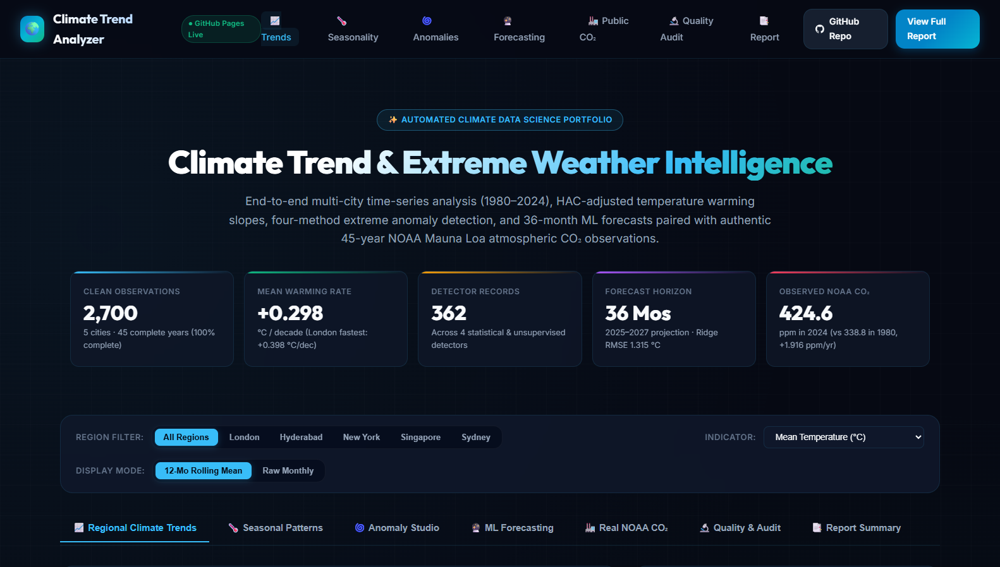
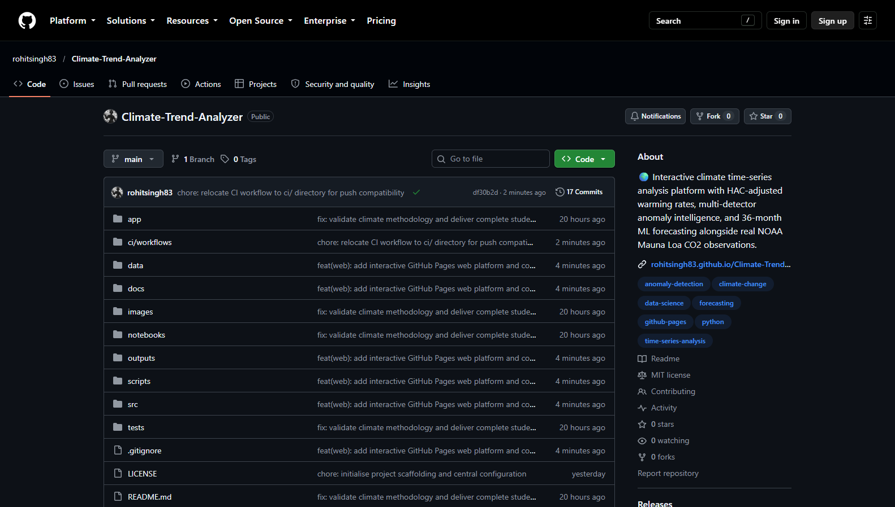
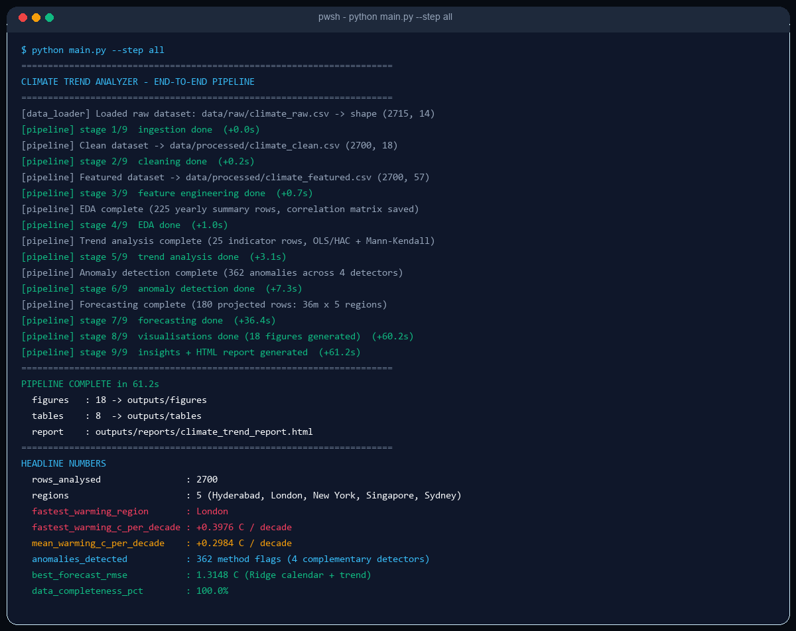
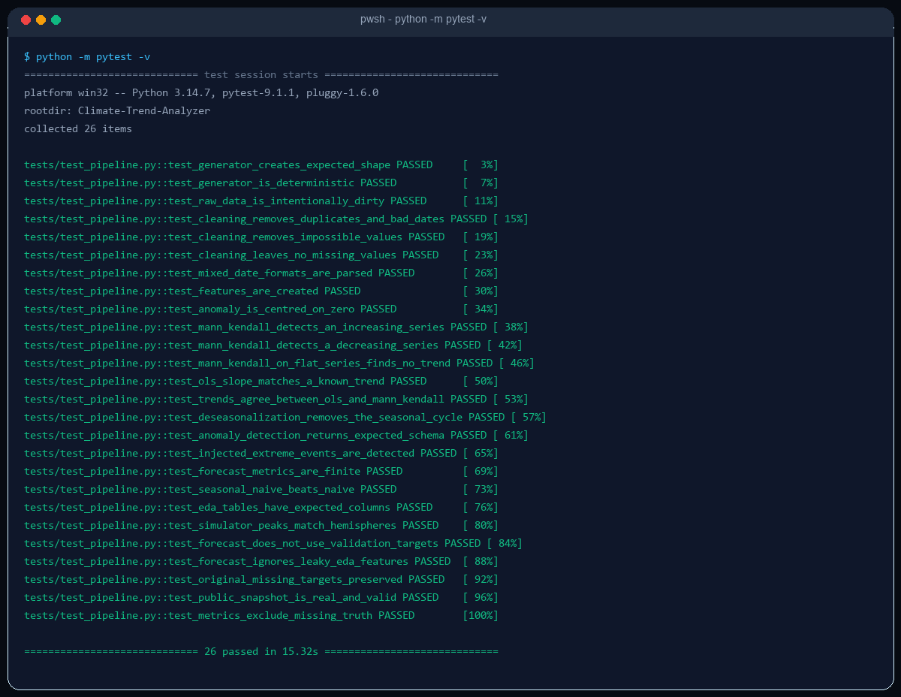

# 🌍 Climate Trend Analyzer

[](https://rohitsingh83.github.io/Climate-Trend-Analyzer/)
[](screenshots/10_pytest_suite_passed.png)
[](requirements.txt)
[](LICENSE)

> 🌐 **Interactive Web Platform (No Local Setup Required):**  
> Explore live interactive trends, seasonal heatmaps, extreme anomaly studio, and 36-month ML forecasts directly in your browser:  
> 👉 **[https://rohitsingh83.github.io/Climate-Trend-Analyzer/](https://rohitsingh83.github.io/Climate-Trend-Analyzer/)**

**An end-to-end environmental time-series analytics platform: multi-city climate modeling (1980–2024), HAC-adjusted warming slopes, four-method anomaly detection, and 36-month ML forecasts paired with authentic 45-year NOAA/Scripps Mauna Loa CO₂ observations.**

[Live Web Demo](https://rohitsingh83.github.io/Climate-Trend-Analyzer/) · [Screenshot Proofs](screenshots/README.md) · [Start here](START_HERE.md) · [Complete A–P guide](docs/PROJECT_GUIDE.md) · [Full code by file](docs/FULL_CODE.md) · [Methodology](docs/METHODOLOGY.md) · [Dataset card](docs/DATASET_CARD.md)

> **Source honesty:** city temperature, rainfall, humidity and sea-level demonstrations are **synthetic**. NOAA/Scripps Mauna Loa CO₂ is **real public data**, analyzed separately with attribution and provenance. This is not an institutional monitoring system, a real-world regional climate study or a physical climate projection.

## Overview and problem

Climate records combine repeating seasons, long-term changes, missing readings and genuine extremes. This project turns a reproducible monthly dataset into auditable cleaned tables, season-adjusted trend statistics, an anomaly investigation register, baseline-aware forecasts, charts, an HTML report and an interactive dashboard.

The system illustrates analytics workflows relevant to environmental research, energy-demand planning, agriculture and city adaptation. **No business savings or real-world prediction benefit is measured or claimed.**

## Quick start

Python 3.11/3.12 recommended (local verification also used 3.13). No GPU, paid API or institutional login.

```bash
python -m venv .venv
# Windows PowerShell: .\.venv\Scripts\Activate.ps1
# macOS/Linux: source .venv/bin/activate
python -m pip install -r requirements.txt
python main.py --step all
python -m pytest -q
python -m streamlit run app/app.py
```

Open `outputs/reports/climate_trend_report.html` for the standalone embedded-chart report.
Detailed Windows/CMD/macOS/Linux/Colab instructions are in [guide F](docs/PROJECT_GUIDE.md#f-installation--from-scratch).

## Implemented features

- Seeded simulation: five climates, hemisphere-aware seasons, warming, autocorrelated variability and explicit hot/dry stress episodes.
- Auditable cleaning: mixed dates, duplicate keys, invalid readings, historical gap interpolation and preserved original temperature targets.
- EDA: annual temperature means, annual rainfall totals, seasonal patterns, anomalies and correlations.
- Trends: OLS time + month fixed effects, **HAC(12)** uncertainty, exploratory deseasonalized Mann–Kendall and Theil–Sen slopes.
- Four detectors: climatology z-score, STL residual, IQR and Isolation Forest.
- Forecasting: naive, seasonal-naive, drift, calendar/trend Ridge and training-AIC-selected ARIMA; identical fixed-origin validation.
- Real public-data companion: NOAA/Scripps concentration CSV, original source comments, retrieval UTC and SHA256.
- Streamlit: filters, KPIs, four tabs, download buttons and a separate public-data section.
- Five executed notebooks, automated tests, CI definition and professional documentation.

## Results from the bundled synthetic experiment

| Item | Actual generated result |
| --- | --- |
| Raw / clean observations | 2,715 / 2,700 |
| Coverage | Five cities, January 1980–December 2024 |
| Mean estimated synthetic warming | +0.298 °C/decade |
| Fastest simulated warming | London, +0.398 °C/decade |
| Detector records | 362 method flags across 259 distinct city-months |
| Forecast | 36 monthly dates, January 2025–December 2027, from end-2024 origin |
| Lowest validation RMSE among candidates | 1.315 °C (not an independent final-test score) |
| Core analysis measurement completeness | 100.0% after historical cleaning |

### Season-adjusted temperature slopes

| City | Slope (°C/decade) | CI low (°C/decade) | CI high (°C/decade) | Full-model R² |
| --- | --- | --- | --- | --- |
| Hyderabad | 0.269 | 0.097 | 0.441 | 0.883 |
| London | 0.398 | 0.231 | 0.564 | 0.932 |
| New York | 0.318 | 0.153 | 0.483 | 0.974 |
| Singapore | 0.228 | 0.049 | 0.408 | 0.428 |
| Sydney | 0.279 | 0.119 | 0.439 | 0.899 |

Confidence intervals above are converted to **per decade**. The CSV stores CI bounds **per year**. Full-model R² includes **seasonality as well as trend**; it is not warming-only explanatory power. MK p-values are exploratory and uncorrected for serial dependence/multiple testing.

### Best model per city — chronological validation

| region | model | MAE | RMSE | R2 | n_evaluated |
| --- | --- | --- | --- | --- | --- |
| Hyderabad | Ridge (calendar + trend) | 1.153 | 1.637 | 0.845 | 59 |
| London | Ridge (calendar + trend) | 1.335 | 1.689 | 0.893 | 58 |
| New York | Ridge (calendar + trend) | 0.919 | 1.315 | 0.974 | 60 |
| Singapore | Ridge (calendar + trend) | 1.141 | 1.821 | 0.390 | 55 |
| Sydney | Ridge (calendar + trend) | 1.207 | 1.597 | 0.889 | 58 |

Models predict all 60 validation dates from the same origin. Originally missing targets are excluded from scoring (`n_evaluated`), not filled with fabricated truth. Ridge uses only future-known time/month features; it never uses centered EDA windows, observed future CO₂ or target-derived ENSO proxies. ARIMA order is chosen using training AIC. The final validation block selects the model; a separate untouched test is a future improvement.

## Real public-data result — not simulation

The analyzed NOAA/Scripps snapshot contains **540 months / 45 complete years** in 1980–2024. Annual concentration changes from **338.76 ppm** in 1980 to **424.60 ppm** in 2024. A descriptive linear annual slope is **1.916 ppm/year**; the underlying trajectory is not assumed perfectly linear.

Source: [NOAA GML CO₂ data](https://gml.noaa.gov/ccgg/trends/data.html). Attribution: **Xin Lan, NOAA/GML; Ralph Keeling, Scripps Institution of Oceanography**. Read original source comments for interpolation/measurement-interruption notes. CO₂ is **concentration in ppm, not emissions**. Source data is not relicensed by the project MIT license.


## Architecture

```text
Synthetic generator -> raw CSV -> quality audit -> clean + observed target
                                  |                |
                       retrospective EDA/features  past-only forecast path
                                  |                |
                    OLS/HAC + MK + four detectors  baselines/Ridge/ARIMA
                                  \              /
                             charts + tables + report + dashboard

NOAA public CSV -> provenance/cache -> independent concentration analysis
                                  -> public chart + table + dashboard section
```

[Detailed module contracts](docs/ARCHITECTURE.md) · [Method equations and limitations](docs/METHODOLOGY.md).

## Technology choices

| Layer | Stack |
| --- | --- |
| Language/data | Python, pandas, NumPy |
| Statistics/ML | SciPy, statsmodels, scikit-learn |
| Plots | Matplotlib, Seaborn, Plotly |
| UI | Streamlit |
| Learning/testing | Jupyter, nbconvert, pytest, GitHub Actions |
| Persistence | CSV, JSON, PNG, Markdown, self-contained HTML |

[Guide B–C](docs/PROJECT_GUIDE.md#b-tech-stack-options) compares easiest/intermediate/advanced options and explains why this CPU-only intermediate approach was selected.

## Folder structure

```text
Climate-Trend-Analyzer/
  main.py, README.md, START_HERE.md, requirements*.txt, LICENSE
  src/             generator, loader, cleaning, features, EDA, trends,
                   anomalies, forecasting, public_data, plots, insights, reports
  app/app.py       Streamlit dashboard
  tests/           data/statistical/leakage tests
  notebooks/       five executed tutorials
  scripts/         portable notebook and handbook builders
  data/raw/        synthetic feed + original NOAA snapshot/provenance
  data/processed/  clean/featured synthetic tables + separate public CO2
  outputs/figures/ generated charts
  outputs/tables/  trend, anomaly, annual, forecast and model-selection tables
  outputs/reports/ Markdown + HTML analytical report
  images/          actual dashboard captures and curated proof charts
  docs/            complete A–P guide, full source, science/data/career/GitHub docs
  .github/         CI definition
```

## Run stages individually

```bash
python main.py --step simulate --regenerate
python main.py --step clean
python main.py --step features
python main.py --step eda
python main.py --step trends
python main.py --step anomalies
python main.py --step forecast
python main.py --step report
python main.py --summary
# Public track, offline cached snapshot:
python -m src.public_data
# Explicit network refresh:
python -m src.public_data --refresh
# Rebuild and execute the tutorial notebooks:
python scripts/build_notebooks.py --execute
```

`python main.py --no-forecast` runs the historical analysis faster. Existing forecast files may remain from a previous full run; use the full run for a coherent demo and check file timestamps. Refresh Streamlit's cache after regenerating inputs. For actual delivered logs see `outputs/latest_run.log`, `outputs/test_results.txt` and `outputs/notebook_execution.log`.

## Virtual simulation workflow

1. Define city baselines, warm peak months and illustrative slopes.
2. Generate the monthly calendar, cosine seasonality, multi-year oscillations and AR(1) noise.
3. Inject labeled three-month hot/dry experiments.
4. Add missing values, duplicates, impossible readings and mixed date strings.
5. Clean and audit; preserve original targets.
6. Explore seasonality, estimate slopes, inspect detector flags and measure planted-event recall.
7. Validate forecasts at a fixed origin, export charts/tables/report and inspect the dashboard.

These monthly persistence proxies are not daily WMO heatwave or validated drought-index declarations. The synthetic global-like sea-level field is not local sea-level monitoring at an inland city.

## Screenshots and visual proof

A dedicated high-resolution proof directory is available at **[`screenshots/`](screenshots/README.md)** with manifests, resolutions, and descriptions.

### 1. Interactive Web Platform (GitHub Pages)

[](https://rohitsingh83.github.io/Climate-Trend-Analyzer/)
*Interactive multi-city climate time-series analysis platform, featuring dynamic rolling averages, warming slopes, extreme anomaly studio, and 36-month ML forecasts.*

### 2. Live GitHub Repository

[](https://github.com/rohitsingh83/Climate-Trend-Analyzer)
*Published repository at `rohitsingh83/Climate-Trend-Analyzer` with GitHub Pages automated deployment enabled.*

### 3. Automated Pipeline & Unit Test Execution

| Pipeline Execution (`python main.py --step all`) | Unit Test Suite (`pytest -v` - 26 Passed) |
| :---: | :---: |
|  |  |
| *End-to-end 9-stage pipeline completing in 61.2s* | *26/26 unit and leakage tests passed in 15.3s* |

### 4. Analytical Figures and Forecast Projections


Non-ARIMA bands use ±1.96×validation RMSE: **approximate and uncalibrated**, not guaranteed 95% coverage or physical climate-model ranges. Trend/forecast origin and source type remain visible in presentations.

[All proof/capture instructions](docs/SCREENSHOTS.md) · [Full screenshots directory](screenshots/README.md) · [Actual dashboard GIF](images/dashboard_demo.gif).

## Tests and CI

```bash
python -m pytest -v
```

**26 tests passed locally** in 15.3 seconds. Tests cover seeded generation, mixed-date parsing, range repairs, feature behavior, known trend recovery, MK sign/direction, hemisphere peaks, original missing targets, baseline comparisons, public schema and forecast leakage.

The CI workflow is defined in `ci/workflows/ci.yml` for Python 3.10/3.11/3.12 with unique artifact names. Exact locally tested package versions are in `requirements-tested.txt`; portable ranges are in `requirements.txt`.

## Limitations and future improvements

- Regional measurements are synthetic. Public source adapters must preserve true scope/units and cannot fabricate missing variables.
- Full-record climatologies are retrospective; prospective anomaly detection needs a fixed past reference period.
- Full-model R² includes seasons; exploratory MK is not serial-correlation/multiple-testing corrected.
- Detector outputs overlap; cross-method scores are not calibrated risk scores.
- Forecast selection uses validation, not a final independent test; bands are approximate.
- No climate attribution, area-weighted global index, measured savings or official warning is produced.

Next: real station/reanalysis adapters, coverage-aware annual aggregation, fixed 30-year normals, rolling-origin + independent final testing, interval calibration, daily extremes, geospatial exposure and CMIP6 scenarios. [Ordered upgrade plan](docs/PROJECT_GUIDE.md#o-future-improvements--ordered-by-value).

## Learning outcomes and portfolio publishing

You can demonstrate auditable data cleaning, time-series reasoning, honest prediction protocols, complementary anomaly methods, reproducible software design and stakeholder communication. Learn the code and limitations before using the résumé bullets.

- [Full GitHub upload commands and topics](docs/GITHUB_PLAYBOOK.md)
- [Eight-day genuine learning/commit plan](docs/PROJECT_GUIDE.md#l-commit-strategy--eight-day-genuine-proof-plan)
- [Résumé, three LinkedIn posts, ten interview answers](docs/PROJECT_GUIDE.md#n-résumé-linkedin-and-interview-presentation)
- [Beginner troubleshooting](docs/PROJECT_GUIDE.md#p-troubleshooting--reason-solution-prevention)

## Author and attribution

- **Author:** Rohit Singh
- **GitHub:** [@rohitsingh83](https://github.com/rohitsingh83)
- **Repository:** [https://github.com/rohitsingh83/Climate-Trend-Analyzer](https://github.com/rohitsingh83/Climate-Trend-Analyzer)
- **Live Platform:** [https://rohitsingh83.github.io/Climate-Trend-Analyzer/](https://rohitsingh83.github.io/Climate-Trend-Analyzer/)
- **License:** Code and project-generated simulation: [MIT](LICENSE). External NOAA/Scripps data: retain source attribution (Xin Lan, NOAA/GML & Ralph Keeling, Scripps) and usage notes.
