# Climate Trend Analyzer - Analytical Report

*Generated on 19 October 2026, 11:31 by the `Climate-Trend-Analyzer` pipeline (seed = 42).*

---

## Executive Summary

| Metric | Value |
| --- | --- |
| Records analysed | 2,700 monthly observations |
| Regions covered | 5 |
| Time span | 1980-01 to 2024-12 |
| Mean warming rate | +0.298 °C per decade |
| Fastest warming region | London (+0.398 °C/decade) |
| Detector records (overlapping methods) | 362 |
| Best forecast RMSE | 1.3148 °C |
| Post-cleaning completeness | 100.00 % |

*Generated automatically on 2026-10-19 11:31 from 2,700 cleaned monthly records (1980-01 to 2024-12) across 5 regions.*

## 1. Data Ingestion & Quality Control

The raw file `data/raw/climate_raw.csv` was generated by the built-in simulator (a virtual stand-in for a real station/portal feed) and contains 2,715 rows with deliberate defects: mixed date formats, duplicated records, missing readings and physically impossible values.

| metric | value |
| --- | --- |
| Rows loaded (raw) | 2715.000 |
| Unparseable dates removed | 0.000 |
| Duplicate rows removed | 15.000 |
| Rows with impossible values | 12.000 |
| Values imputed | 132.000 |
| Rows in analysis table | 2700.000 |
| Completeness (%) | 100.000 |

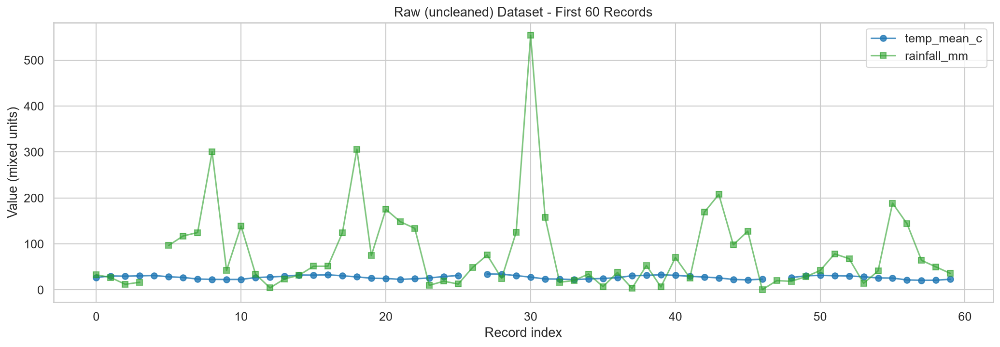

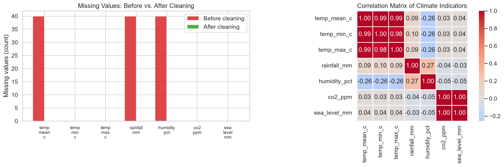

## 2. Exploratory Data Analysis

### Descriptive statistics

| indicator | count | mean | std | min | 25% | 50% | 75% | max | skew | kurtosis | missing | unit |
| --- | --- | --- | --- | --- | --- | --- | --- | --- | --- | --- | --- | --- |
| temp_mean_c | 2700.000 | 20.152 | 8.775 | -1.100 | 13.798 | 21.950 | 27.410 | 39.000 | -0.458 | -0.804 | 0 | degC |
| temp_min_c | 2700.000 | 15.708 | 8.841 | -6.460 | 9.635 | 17.555 | 22.660 | 35.390 | -0.475 | -0.674 | 0 | degC |
| temp_max_c | 2700.000 | 24.592 | 8.842 | 3.390 | 17.987 | 26.205 | 32.010 | 41.810 | -0.421 | -0.896 | 0 | degC |
| rainfall_mm | 2700.000 | 108.963 | 135.120 | 0.100 | 28.100 | 65.650 | 138.375 | 1558.300 | 3.301 | 16.850 | 0 | mm |
| humidity_pct | 2700.000 | 68.944 | 10.050 | 42.600 | 61.200 | 68.500 | 77.600 | 92.300 | -0.080 | -0.844 | 0 | % |
| co2_ppm | 2700.000 | 395.676 | 36.834 | 334.920 | 363.288 | 392.905 | 426.912 | 466.210 | 0.178 | -1.172 | 0 | ppm |
| sea_level_mm | 2700.000 | 58.033 | 41.182 | -2.600 | 21.175 | 52.150 | 91.600 | 140.600 | 0.337 | -1.110 | 0 | mm |

### Correlation matrix

| indicator | temp_mean_c | temp_min_c | temp_max_c | rainfall_mm | humidity_pct | co2_ppm | sea_level_mm |
| --- | --- | --- | --- | --- | --- | --- | --- |
| temp_mean_c | 1.00 | 0.99 | 0.99 | 0.09 | -0.26 | 0.03 | 0.04 |
| temp_min_c | 0.99 | 1.00 | 0.97 | 0.10 | -0.26 | 0.03 | 0.04 |
| temp_max_c | 0.99 | 0.97 | 1.00 | 0.09 | -0.26 | 0.03 | 0.04 |
| rainfall_mm | 0.09 | 0.10 | 0.09 | 1.00 | 0.28 | -0.04 | -0.03 |
| humidity_pct | -0.26 | -0.26 | -0.26 | 0.28 | 1.00 | -0.05 | -0.05 |
| co2_ppm | 0.03 | 0.03 | 0.03 | -0.04 | -0.05 | 1.00 | 1.00 |
| sea_level_mm | 0.04 | 0.04 | 0.04 | -0.03 | -0.05 | 1.00 | 1.00 |

### Warmest years in the record

| year | temp_mean | rainfall_total | humidity_mean | co2_mean | sea_level_mean | temp_anomaly | extreme_events |
| --- | --- | --- | --- | --- | --- | --- | --- |
| 2020 | 21.807 | 1120.860 | 66.760 | 449.213 | 119.767 | 1.655 | 12 |
| 2019 | 21.310 | 1625.740 | 67.895 | 445.573 | 115.532 | 1.158 | 5 |
| 2005 | 21.151 | 1124.780 | 67.492 | 401.511 | 61.730 | 0.999 | 5 |
| 2023 | 21.124 | 1396.640 | 67.698 | 459.316 | 133.572 | 0.972 | 0 |
| 1990 | 20.974 | 1311.820 | 68.065 | 361.375 | 19.432 | 0.822 | 5 |
| 2024 | 20.864 | 1144.300 | 67.880 | 462.984 | 138.048 | 0.713 | 1 |
| 2015 | 20.824 | 1561.340 | 67.627 | 432.438 | 99.058 | 0.672 | 1 |
| 2011 | 20.724 | 1661.880 | 68.422 | 419.676 | 83.454 | 0.572 | 1 |
| 2007 | 20.673 | 1373.180 | 68.588 | 407.497 | 68.521 | 0.521 | 1 |
| 2010 | 20.654 | 1597.340 | 67.760 | 416.613 | 79.748 | 0.503 | 7 |

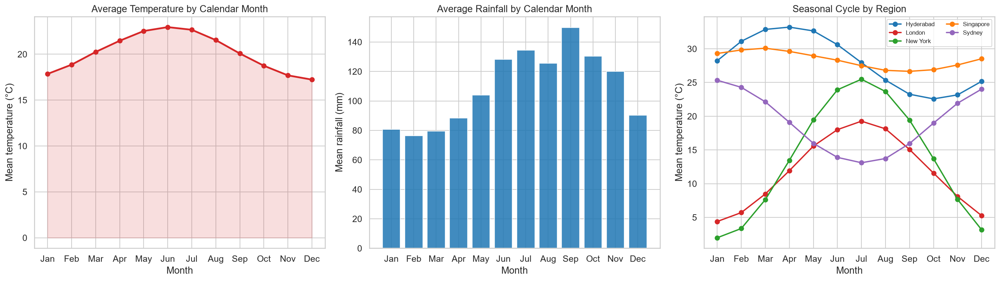

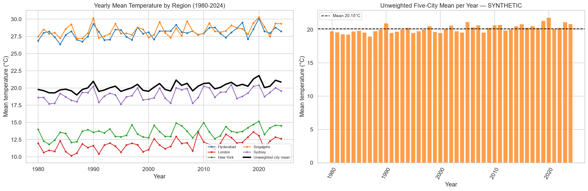

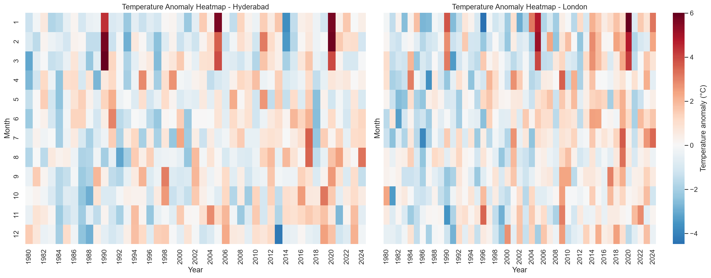

## 3. Trend Analysis

Ordinary Least Squares (parametric) and the Mann-Kendall test (non-parametric) were applied to every region x indicator combination.

### Temperature trends

| region | indicator | slope_per_year | slope_per_decade | ci_low | ci_high | r_squared | r_squared_raw | p_value | significance | trend_basis | mk_trend | mk_s | mk_z | mk_p_value | theil_sen_slope_per_year |
| --- | --- | --- | --- | --- | --- | --- | --- | --- | --- | --- | --- | --- | --- | --- | --- |
| London | temp_mean_c | 0.040 | 0.398 | 0.023 | 0.056 | 0.932 | 0.010 | 0.000 | significant | OLS month fixed effects; HAC(12) CI; MK deseasonalised | increasing | 33706 | 8.047 | 0.000 | 0.038 |
| New York | temp_mean_c | 0.032 | 0.318 | 0.015 | 0.048 | 0.974 | 0.003 | 0.000 | significant | OLS month fixed effects; HAC(12) CI; MK deseasonalised | increasing | 28469 | 6.797 | 0.000 | 0.030 |
| Sydney | temp_mean_c | 0.028 | 0.279 | 0.012 | 0.044 | 0.899 | 0.006 | 0.001 | significant | OLS month fixed effects; HAC(12) CI; MK deseasonalised | increasing | 23515 | 5.614 | 0.000 | 0.026 |
| Hyderabad | temp_mean_c | 0.027 | 0.269 | 0.010 | 0.044 | 0.883 | 0.005 | 0.002 | significant | OLS month fixed effects; HAC(12) CI; MK deseasonalised | increasing | 25157 | 6.006 | 0.000 | 0.027 |
| Singapore | temp_mean_c | 0.023 | 0.228 | 0.005 | 0.041 | 0.428 | 0.022 | 0.013 | significant | OLS month fixed effects; HAC(12) CI; MK deseasonalised | increasing | 22739 | 5.429 | 0.000 | 0.023 |

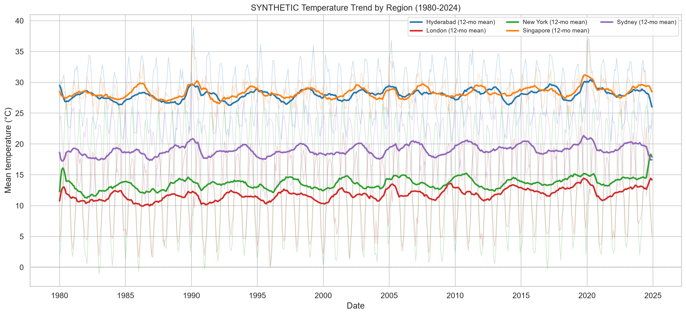

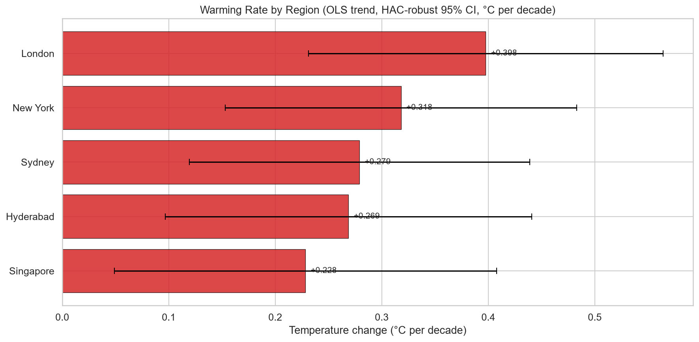

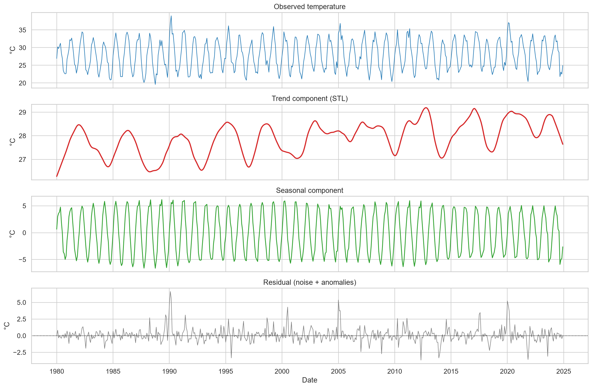

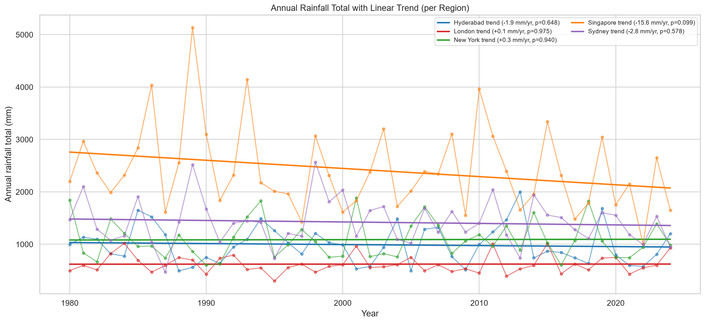

## 4. Anomaly Detection

362 detector records were registered (methods can flag the same city-month) by the four-method ensemble. The full register is saved to `outputs/tables/anomalies.csv`.

### Anomalies per region

| region | total | high | hot | cold |
| --- | --- | --- | --- | --- |
| Hyderabad | 67 | 22 | 39 | 14 |
| London | 63 | 16 | 33 | 16 |
| New York | 75 | 27 | 34 | 27 |
| Singapore | 103 | 22 | 46 | 19 |
| Sydney | 54 | 18 | 25 | 15 |

### Ten most extreme anomalies

| date | region | variable | method | value | expected | deviation | score | severity | direction | description | anomaly_id |
| --- | --- | --- | --- | --- | --- | --- | --- | --- | --- | --- | --- |
| 2020-01-01 00:00:00 | Singapore | temp_mean_c | stl_residual | 36.900 | 29.680 | 7.220 | 6.076 | high | hot | Unexpected 36.9°C month: residual +7.2°C (+6.1σ) | ANM-0321 |
| 1990-02-01 00:00:00 | Hyderabad | temp_mean_c | stl_residual | 36.960 | 30.330 | 6.630 | 6.071 | high | hot | Unexpected 37.0°C month: residual +6.6°C (+6.1σ) | ANM-0081 |
| 1990-01-01 00:00:00 | Sydney | temp_mean_c | stl_residual | 31.700 | 25.260 | 6.440 | 5.808 | high | hot | Unexpected 31.7°C month: residual +6.4°C (+5.8σ) | ANM-0077 |
| 2005-01-01 00:00:00 | London | temp_mean_c | stl_residual | 9.170 | 2.370 | 6.800 | 5.675 | high | hot | Unexpected 9.2°C month: residual +6.8°C (+5.7σ) | ANM-0195 |
| 2005-03-01 00:00:00 | New York | temp_mean_c | stl_residual | 13.460 | 7.250 | 6.210 | 5.615 | high | hot | Unexpected 13.5°C month: residual +6.2°C (+5.6σ) | ANM-0213 |
| 1990-02-01 00:00:00 | Singapore | temp_mean_c | stl_residual | 36.060 | 29.500 | 6.560 | 5.523 | high | hot | Unexpected 36.1°C month: residual +6.6°C (+5.5σ) | ANM-0086 |
| 2020-02-01 00:00:00 | Singapore | temp_mean_c | stl_residual | 36.240 | 29.880 | 6.360 | 5.354 | high | hot | Unexpected 36.2°C month: residual +6.4°C (+5.4σ) | ANM-0335 |
| 2004-01-01 00:00:00 | London | temp_mean_c | stl_residual | 7.570 | 1.260 | 6.310 | 5.265 | high | hot | Unexpected 7.6°C month: residual +6.3°C (+5.3σ) | ANM-0187 |
| 2005-01-01 00:00:00 | Singapore | temp_mean_c | stl_residual | 34.200 | 28.000 | 6.200 | 5.216 | high | hot | Unexpected 34.2°C month: residual +6.2°C (+5.2σ) | ANM-0199 |
| 2005-02-01 00:00:00 | London | temp_mean_c | stl_residual | 10.850 | 4.610 | 6.240 | 5.207 | high | hot | Unexpected 10.8°C month: residual +6.2°C (+5.2σ) | ANM-0203 |

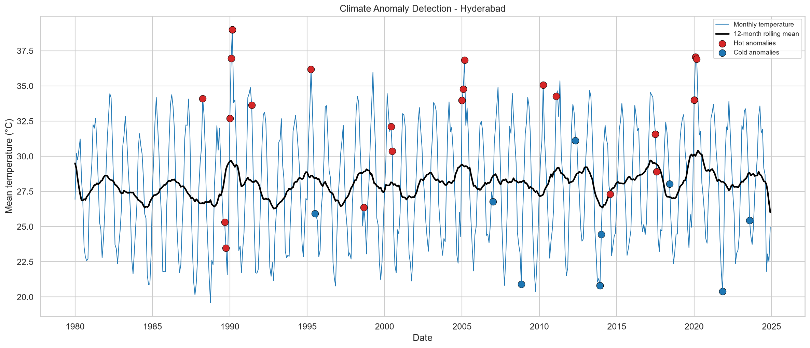

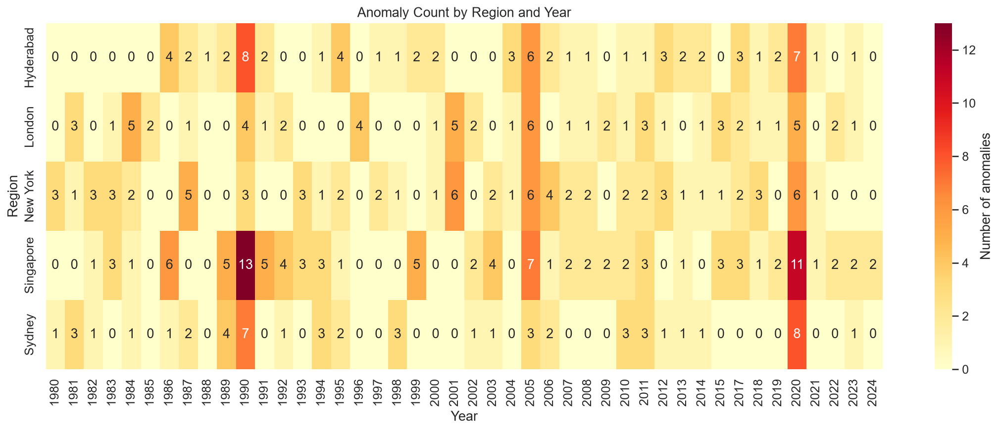

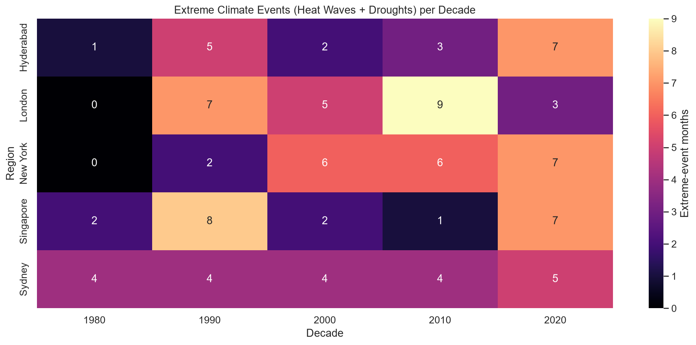

## 5. Forecasting

Every model was scored on the same 60-month chronological validation window, then the winner was refit on the full series to project the next 36 months.

| model | MAE | RMSE | R2 | n_evaluated | region |
| --- | --- | --- | --- | --- | --- |
| Ridge (calendar + trend) | 1.153 | 1.637 | 0.845 | 59 | Hyderabad |
| ARIMA(2, 0, 2) | 1.566 | 2.021 | 0.763 | 59 | Hyderabad |
| Seasonal naive | 1.705 | 2.224 | 0.714 | 59 | Hyderabad |
| Drift (linear) | 3.672 | 4.254 | -0.048 | 59 | Hyderabad |
| Naive | 3.677 | 4.257 | -0.049 | 59 | Hyderabad |
| Ridge (calendar + trend) | 1.335 | 1.689 | 0.893 | 58 | London |
| ARIMA(2, 0, 2) | 1.924 | 2.444 | 0.777 | 58 | London |
| Seasonal naive | 2.263 | 2.760 | 0.715 | 58 | London |
| Drift (linear) | 6.746 | 8.066 | -1.433 | 58 | London |
| Naive | 6.838 | 8.168 | -1.495 | 58 | London |
| Ridge (calendar + trend) | 0.919 | 1.315 | 0.974 | 60 | New York |
| ARIMA(2, 0, 2) | 1.191 | 1.603 | 0.962 | 60 | New York |
| Seasonal naive | 1.396 | 1.739 | 0.955 | 60 | New York |
| Naive | 12.197 | 14.684 | -2.215 | 60 | New York |
| Drift (linear) | 12.202 | 14.687 | -2.217 | 60 | New York |
| Ridge (calendar + trend) | 1.141 | 1.821 | 0.390 | 55 | Singapore |
| ARIMA(2, 0, 2) | 1.682 | 2.210 | 0.102 | 55 | Singapore |
| Seasonal naive | 1.705 | 2.317 | 0.013 | 55 | Singapore |
| Naive | 3.031 | 3.437 | -1.170 | 55 | Singapore |
| Drift (linear) | 3.217 | 3.608 | -1.392 | 55 | Singapore |
| Ridge (calendar + trend) | 1.207 | 1.597 | 0.889 | 58 | Sydney |
| ARIMA(2, 0, 2) | 1.409 | 1.783 | 0.862 | 58 | Sydney |
| Seasonal naive | 1.681 | 2.048 | 0.818 | 58 | Sydney |
| Naive | 7.656 | 8.861 | -2.410 | 58 | Sydney |
| Drift (linear) | 7.861 | 9.039 | -2.549 | 58 | Sydney |

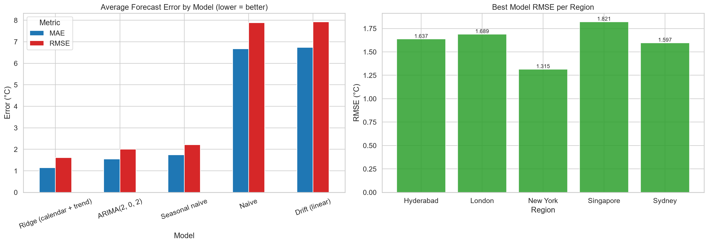

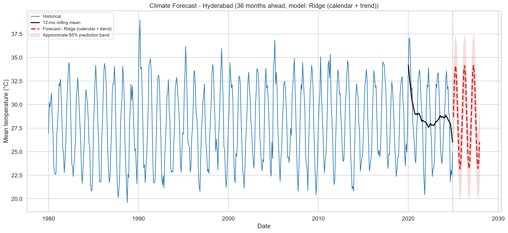

## 6. Drivers: CO2, Sea Level and Correlation Structure

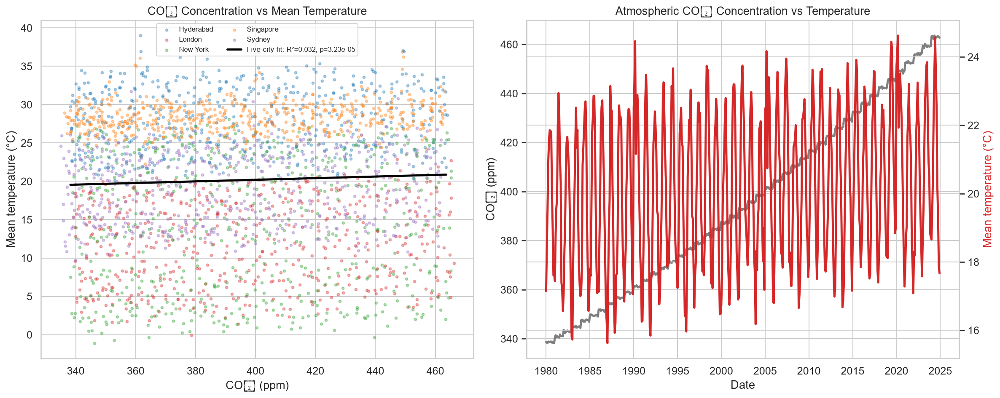

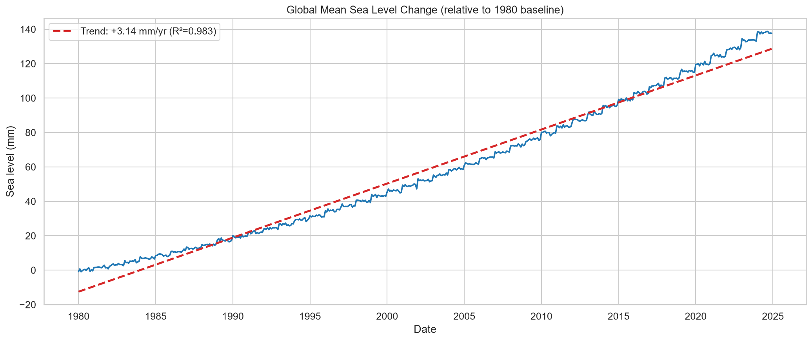

## 7. Key Findings

*Generated automatically on 2026-10-19 11:31 from 2,700 cleaned monthly records (1980-01 to 2024-12) across 5 regions.*

### 1. Warming trend

- **Synthetic warming signal.** 5 of 5 simulated regions show a statistically significant positive temperature trend (19 of 25 region x indicator combinations are significant at p < 0.05).
- **Fastest synthetic warming:** London at **0.398 °C per decade** (OLS slope 0.0398 °C/yr, full model R² (including seasonal effects) = 0.932, p = 3.00e-06).
- **Slowest warming:** Singapore at 0.228 °C per decade.
- **Mann-Kendall (non-parametric) test** confirms the trend for 5/5 regions (all ['increasing']).
- Regional spread in warming rate is **0.169 °C/decade**, i.e. the same climate driver produces very different local impacts - which is exactly why regionalisation matters for policy.

### 2. Seasonal structure

- **Every region has its own seasonal peak:** Hyderabad (April), London (July), New York (July), Singapore (March), Sydney (January). The ~6-month phase shift between the northern and southern hemispheres (London peaks in July, Sydney in January) is exactly what a climate-aware model has to capture.
- The seasonal swing differs sharply by climate: **New York** swings 23.5 °C between its warmest and coolest month, while **Singapore** swings only 3.4 °C - a 6x difference in seasonal amplitude.
- 4 distinct peak months appear across the 5 regions, confirming the simulator reproduces hemisphere-aware seasonality.
- Seasonality is the main source of variance, so every model in this project uses a 12-month baseline (climatology) or a seasonal-naive benchmark, and every trend statistic is computed on a **deseasonalised** series.

### 3. Anomalies and extreme events

- **362 detector records** were detected by the four-method ensemble (z-score, STL residual, IQR, Isolation Forest).
- Detector-record direction split (methods can flag the same month): **177 hot**, **91 cold**, **0 dry**, **75 wet** months.
- Most extreme event: **Unexpected 36.9°C month: residual +7.2°C (+6.1σ)** in Singapore on 01 Jan 2020 (score 6.076).
- Heat-wave + drought months occur at **0.1 per year** in the 1980s and **1.2 per year** in the 2020s - a rising rate (728.6 % more). (The 2020s are a partial decade, so the rate is used instead of the raw count.)
- The mean warming rate is 0.298 °C/decade; extremes and the mean therefore move **in the same direction**, but these planted simulation episodes are not evidence that real-world extreme frequency increased.

### 4. Drivers

- Atmospheric CO₂ and mean temperature have a monthly, unweighted five-city correlation of **r = 0.178** (Pearson, monthly unweighted five-city means).
- CO₂ is rising at about **28.29 ppm per decade** (R² = 0.995) (concentration, not emissions).
- Shared time trends can create spurious correlation; these simulated associations do not establish causal attribution. This five-city mean is NOT a global climate index.

### 5. Forecasting

- The best model per region was selected by **60-month chronological validation**: Hyderabad -> Ridge (calendar + trend), London -> Ridge (calendar + trend), New York -> Ridge (calendar + trend), Singapore -> Ridge (calendar + trend), Sydney -> Ridge (calendar + trend).
- Lowest validation RMSE among candidates: **1.315 °C** on a monthly average temperature series.
- **Singapore**: projected mean temperature in December 2027 = **29.04 °C**.
- **London**: projected mean temperature in December 2027 = **6.50 °C**.
- **Hyderabad**: projected mean temperature in December 2027 = **26.03 °C**.
- **New York**: projected mean temperature in December 2027 = **4.24 °C**.
- **Sydney**: projected mean temperature in December 2027 = **24.91 °C**.
- Production note: the 36-month projection is a *trend continuation* scenario, not a physical climate model. For policy-grade numbers, this pipeline would be pointed at CMIP6/IPCC scenarios instead of a statistical extrapolation.

### 6. Data quality

- The raw file contained **2,715 rows**; after removing 15 unusable records (bad dates / duplicates) the analysis table holds **2,700 rows**.
- **132 values** were imputed and **12 rows** contained physically impossible readings (e.g. -999 °C sensor dropouts) that were flagged and repaired.
- Final completeness: **100.00 %**.

### 7. Business & policy implications

- **Energy & utilities:** a reliable regional warming signal supports peak-demand and cooling-load planning; no cost savings are measured by this project.
- **Agriculture:** seasonal rainfall anomalies identify drought and flood risk windows for crop planning and irrigation scheduling.
- **Insurance & finance:** anomaly frequency and trend severity are the inputs for parametric weather-risk pricing and climate exposure disclosure.
- **Urban planning & public health:** heat-wave month counts translate directly into cooling-centre, heat-health-alert and infrastructure design criteria.
- **Sustainability reporting:** the pipeline produces reproducible, auditable tables and charts that can be embedded in ESG / TCFD disclosures.

### 8. Limitations and next steps

- The dataset is a **simulation**: it reproduces realistic statistical structure (seasonality, autocorrelation, trends, extremes) but it is not an observational record.
- The statistical models extrapolate; they do not model physical climate feedbacks.
- Next: replace the simulator with a public dataset (NASA GISTEMP, NOAA, Our World in Data), add CMIP6 scenarios, and validate the forecasts against published indices.

## Separate real public-data companion — NOAA/Scripps CO2

Real public observations are analyzed independently, never joined to synthetic cities. Concentration is in ppm, not emissions. Source/citation and retrieval checksum are preserved in data/raw/noaa_provenance.json.

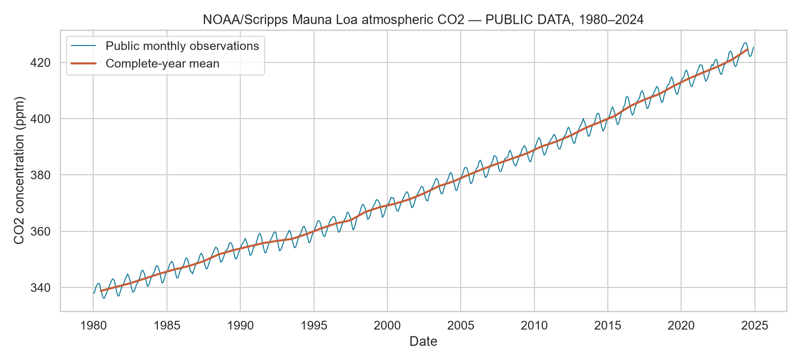

## 8. Methodology Notes & Limitations

- The input is a **simulated** dataset that reproduces realistic statistical structure; it is not an observational climate record.
- OLS uses monthly fixed effects and HAC(12) uncertainty. Full-model R² includes seasonality. MK is a descriptive cross-check without serial-dependence or multiple-testing adjustment.
- Forecasts are fixed-origin statistical extrapolations from end-2024, not physical climate-model projections. Model selection uses a validation block, not an independent test; non-ARIMA bands are approximate and uncalibrated.
- Anomaly thresholds (z > 2.5, |STL residual| > 2 sigma, IQR fences, 2 % Isolation Forest contamination) are configurable in `src/config.py`.

---

*Report generated by `src/report_generator.py` - every number above is reproduced by running `python main.py --step all`.*